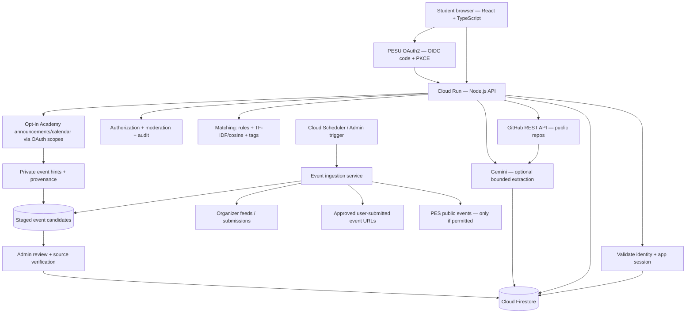
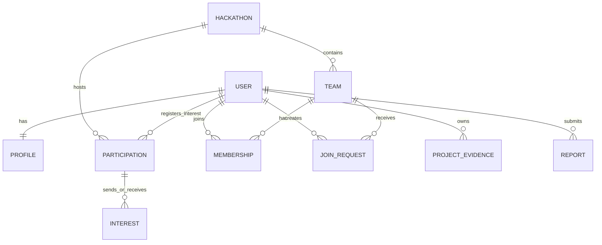
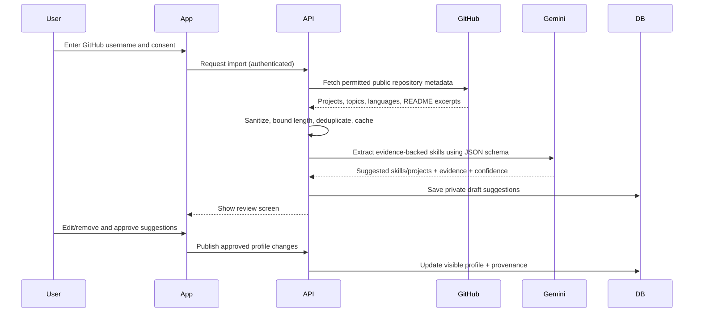
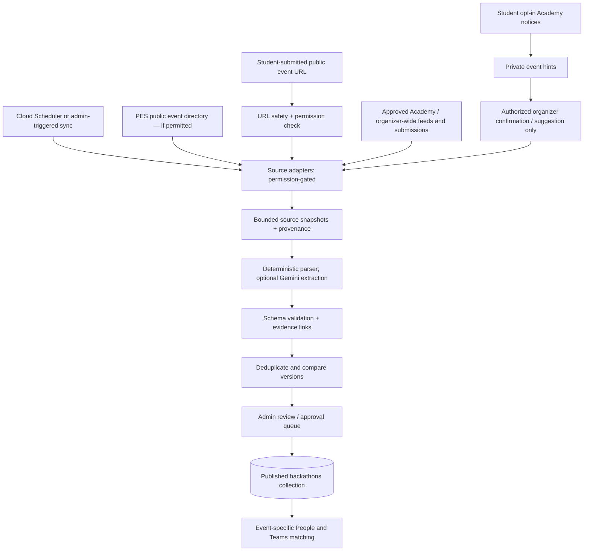

# PES Hackathon Team Finder — Product & Technical Architecture

**Status:** Proposed architecture for discussion — v0.3 (Academy-aware event discovery, student-suggested event URLs, interest onboarding, low-cost ML matching; UI direction deferred)  
**Date:** 13 November 2026  
**Audience:** Product owner, student collaborators, and the Google AI Studio coding agent  
**Working name:** *Assemble* (placeholder, not a brand decision)  
**Launch scope:** PES University students; multiple hackathons, multiple campuses configurable  
**Implementation posture:** Web app, real authentication and persistent data, modular AI and event ingestion, hosted after a pilot  
**Revision notes:** Retains confirmed Hybrid People/Teams tabs and defers all visual/UI directions; adds explicit Academy-first discovery investigation with consented read access and publication boundaries, user-submitted event URLs, event-type filtering, guided interest onboarding, project-based technical icebreakers, and a mostly deterministic/locally computed ML ranking stack. This revision does not authorize unrestricted Academy access.

---

## 1. One-paragraph product brief

Build a student-only hackathon teammate discovery platform where a PES University student can select a hackathon, indicate whether they are looking for a team or recruiting for one, and browse relevant students or open teams with a swipe-based discovery flow and two explicit tabs: **People** and **Teams**. Profiles emphasize **skills, projects, evidence, interests, roles, collaboration preferences, and event-specific availability** rather than profile photos. Students express interest, connect through mutual interest or approved requests, and form teams that respect the hackathon's size and deadlines. With permission, Gemini can help summarize publicly available GitHub project information and information explicitly supplied by the student, while lightweight ML and deterministic rules handle discovery and compatibility. Human-readable reasons explain why a person/team was recommended.

**Product promise:** “Find people you can actually build with.”

**Confirmed product decision (13 November 2026):** **Hybrid discovery** — separate **People** and **Teams** tabs within each selected hackathon. This is a locked functional requirement; visual styling remains undecided.

**New integration objective:** Investigate PESU Academy announcements as a *first-class event-discovery input*, complement it with official/organizer feeds and student-submitted links (including Unstop where permitted), and normalize/verify event metadata. Academy account scope and redistribution permission are distinct: accessing the data is not a license to republish it.

### Problem
- Hackathon teammate discovery currently depends on existing friend groups, ad hoc messages, and chance.
- Students new to hackathons lack a strong network or polished portfolio.
- Existing teams need **complementary** skills, not necessarily people with the most impressive-looking profiles.
- Each hackathon has different team-size rules, timing, and eligibility.

### Non-goals for v1
- Dating, appearance-based scoring, or social popularity rankings.
- Automatic collection of arbitrary personal information from the internet.
- Scraping LinkedIn, pooling student Academy sessions, or relying on unofficial LeetCode endpoints.
- Replacing official hackathon registrations or guaranteeing entry.
- A full recruitment platform for companies, AI agents that autonomously DM students, or a native mobile app.

---

## 2. Key product decisions to settle

| Decision | Proposed v1 default | Why / alternative |
|---|---|---|
| Discovery scope | Within a selected hackathon | Essential for availability and team-size compatibility; add general networking later |
| Discovery units | **CONFIRMED: Hybrid; separate People and Teams tabs** | Both browse types are first-class, each scoped to a selected event |
| User mode | **Looking for team**, **Recruiting**, or **Open to either** per event | Same student may have different roles across events |
| Connection mechanic | Right-swipe = interest request; pass = dismiss; conversation only when accepted/mutual | Avoids unsolicited DMs and ambiguity |
| Team membership | At most one active team per user per hackathon | Prevents conflicting commitments |
| Team sizes | Team-specific target bounded by the hackathon's minimum/maximum | Hackathon limits override individual preferences |
| Event directory | **Academy notice discovery (consent-limited) + permitted public/organizer feeds + submitted URLs → review queue → verified directory** | Academy can reveal missing events, but individual account data cannot be pooled or republished without authorization |
| Institutional verification | PESU OAuth2 (OIDC + PKCE), with a fallback pilot method only if needed | Community-run service, production onboarding/availability needs confirmation; never collect Academy passwords |
| Profiles | User-approved, editable skill cards with evidence links | AI suggestions can be incorrect |
| Photos | Optional, secondary to work | Keep product professional and skill-led |
| AI scope | Optional profile/event extraction on cache miss; template icebreakers; non-LLM ranking | Gemini should not sit on the critical path for every card, swipe, or interaction |
| Messaging | One-to-one after acceptance; team chat after joining; opt-in technical icebreakers | No unsolicited or auto-sent messages |
| Hosting | AI Studio → Cloud Run; Firebase for app data/session integration | PESU OIDC is the identity provider, not a Firebase Google-domain check |
| Recommendation engine | Rules + tag overlap + TF-IDF/cosine + local popularity-normalized exploration | Start explainable and cheap; upgrade to embeddings/learned ranker only after a real pilot |
| Onboarding | Skills, interests, project themes, desired role, work style, event availability | Useful matches even without GitHub history |
| Event-type policy | Strict distinction among team competitions, workshops, talks and seminars | Do not fill hackathon feed with generic technical events |

**Open questions:** Is launch restricted to one PES campus or all campuses? Are external hackathons included? Will organizers claim/manage listings? Can organizers permit automated indexing of public event pages? People-to-people matching is proposed as mutual interest; team joining remains approval-based. **Hybrid discovery is no longer an open question.**

---

## 3. Personas and main journeys

### Persona A — Solo student
1. Signs in and verifies PES student eligibility.
2. Selects a hackathon and marks “Looking for a team.”
3. Selects interest chips, preferred problem domains, skills offered, desired responsibilities, schedule, preferred work style and remote/onsite preferences; can optionally write a brief technical one-liner.
4. Imports public GitHub projects, reviews Gemini's suggestions, and publishes profile.
5. Switches between **People** and **Teams** discovery; reviews details and expresses interest.
6. Receives an accepted match, chats, and joins a team.
7. Updates status to “On a team”; discovery eligibility changes immediately.

### Persona B — Existing team leader
1. Selects a hackathon and creates a team with target size and open roles.
2. Adds current confirmed members (invitation/acceptance flow; no claiming members without consent).
3. Sees candidates whose skills complement the existing roster.
4. Sends invites or reviews applications.
5. Accepts candidates until capacity is reached; all competing invites/applications update atomically.

### Persona C — First-time hacker without GitHub
1. Selects 3–5 interests, 1–3 activities to try, and optionally a question they would enjoy solving; no portfolio required.
2. Adds coursework, classroom projects, hackathon ideas, or a one-paragraph introduction.
3. Receives suggestions based on interests and availability, without a punitive “no experience” score.

### Event lifecycle
**Draft → Published → Registration closed → Event in progress → Completed → Archived.** The site preserves team history by event but turns off stale discovery. Participation may be withdrawn; membership changes must follow explicit rules.

---

## 4. Scope by release

### MVP — must work end to end
- **PESU OAuth2 sign-in** (OIDC authorization code + PKCE) when an approved application is available; gate student-only access using verified provider claims; create/edit profile, skill tags and project links. Pilot-only alternate verification must be documented and cannot assume ordinary Google sign-in proves student status.
- Hackathon directory with **manually verified events** and a **review queue** for Academy-derived *private hints*, approved public/organizer sources and user-submitted event URLs (e.g., Unstop if allowed); include dates, timezone, venue, themes, format, registration URL, eligibility, min/max team size and deadlines; unknown fields are explicitly marked unconfirmed.
- Interest-based onboarding (domain interests, preferred projects, values/work preferences, self-described skills, optional technical one-liner); per-hackathon participation (“looking”, “recruiting”, “not looking”), role preferences, and availability.
- Create team; apply to join; invite a student; approve/reject; leave team; team capacity and membership enforcement.
- **Hybrid discovery** within each event: separate **People** and **Teams** tabs, filters, pass/interest, match/requests inbox; compatibility reasons combine shared interests with complementary role coverage.
- Post-acceptance messaging or a minimal secure team conversation.
- GitHub public-repo import with cached, Gemini-suggested skills/projects and **mandatory user review**; no LLM requests are needed to display or rank most discovery cards.
- Technical icebreaker suggestions assembled from approved project/interest tags, shown as optional draft text only (never auto-sent); notifications, block/report, admin moderation, and usable browser/mobile interactions (visual decisions deferred).

### Phase 2 — meaningful improvements
- GitHub sync/refresh controls; richer contribution evidence without pretending stars or commits prove skill.
- Recommendation explanations and improved ranking from opt-in feedback; optional locally computed text embeddings and cluster-based discovery if the initial TF-IDF/tag system underperforms.
- Team skill gap visualization, team compatibility view, and organizer dashboard.
- Email notification preferences, event-source sync reliability improvements, and optional approved calendar export.
- Optional manual portfolio PDF or LinkedIn export parsing if user consents.

### Phase 3 — only if the pilot proves demand
- Personalized event recommendations, organizer/club accounts, wider inter-college support.
- Availability calendar integration, richer team coordination, verified event feeds.
- PostgreSQL migration if relational analytics/constraints become a limiting factor.
- PWA installability and more advanced discovery (not native apps by default).

---

## 5. Proposed system architecture



### Stack recommendation

| Layer | Choice | Reason |
|---|---|---|
| Build environment | Google AI Studio Build mode + GitHub sync | Generates and iterates full-stack code; can export and maintain normal repository |
| Frontend | React + TypeScript | AI Studio-supported runtime; UI design and styling choices explicitly deferred |
| Backend | Node.js API running server-side in AI Studio/Cloud Run | Keeps secrets, authorization, rate limiting, and transactional writes off the browser |
| Identity | **PESU OAuth2** OIDC; backend-for-frontend session and secure server-side token handling | Verified PES identity without our app handling Academy passwords; Firebase Auth custom-token bridge is optional, not automatic |
| Database | Cloud Firestore | Native AI Studio/Firebase integration and real-time capability for pilot |
| AI | Optional Gemini through server-side SDK, using JSON Schema output | Onboarding enrichment and hard event extraction cases only, with cache and strict request budgets |
| Matching/ML | Server-side TypeScript feature extraction: normalized tags + TF-IDF/cosine + weighted rules; optional offline sentence embeddings later | Works cheaply with a small user base and remains explainable; no Gemini call per swipe |
| External data | GitHub REST API; permission-checked PES Academy-derived notices; PES public events; organizer feeds; student-submitted public event URLs | Keep private Academy inputs separate from publishable event metadata and do not treat external URLs as trusted |
| File storage | Firebase Storage only when necessary | Avatars and voluntary uploads; avoid collecting PDFs in v1 |
| Hosting | Cloud Run via AI Studio Publish; Cloud Scheduler job for permitted event sync | Hosted pilot with supervised ingestion and quotas; check billing and limits |
| Diagnostics | Cloud Run logs; basic application event metrics | Operational visibility without invasive profiling |

**Architecture preference:** Begin with a **modular monolith**, not microservices. Use feature modules for profiles, hackathons, teams, discovery, AI enrichment, and moderation. For the first pilot, Firestore minimizes setup; if strong joins, search, or relational constraints dominate later, Cloud SQL PostgreSQL is a supported platform option. This does not require rewriting the frontend if the data layer is encapsulated.

**Security boundary:** Browsers never call Gemini with a secret API key or perform privileged team transitions directly. Sensitive writes use backend authorization and transactions. Firebase access must be denied by default unless the app has explicitly established an authenticated user session **bridged from the PESU OIDC identity**. An OIDC token is **not** automatically a Firebase Auth ID token; use a server-validated custom-token bridge or server-only Firestore reads/writes. Firestore server Admin SDK bypasses client Security Rules and requires explicit authorization checks. Store PESU OAuth refresh/access tokens only in a secure server-side session store if needed; never expose them to Firestore public documents or browsers. For basic identity-only login, request no Academy data scopes.

---

## 6. Domain model

The core unit of matching is a **Participation**: one student's intentions within one hackathon. A global profile and GitHub portfolio are reusable, but desired roles, availability and team status are event-specific.



### Main records (logical design)

**users/{uid}**  
`displayName`, `campus`, `program` (optional), `graduationYear` (optional), `verificationStatus`, `createdAt`, `accountStatus`, `privacyPreferences`; keep email in **private** identity/verification storage, not public profile.

**profiles/{uid}**  
`headline`, `about`, `skillTags[]`, `interestTags[]`, `projectDomains[]`, `topicsToExplore[]`, `preferredRoles[]`, `workingStyleTags[]`, `icebreakerPrompt?`, `portfolioLinks[]`, `featuredProjects[]`, `githubUsername`, `visibility`, `profilePhotoUrl?`, `updatedAt`. Public profile is an explicit allowlist, never the whole auth record.

**hackathons/{hackathonId}**  
`name`, `description`, `eventType` (hackathon/ideathon/buildathon/CTF/etc), `themes[]`, `venue` (name, campus, building, room, address?; nullable fields), `format` (online/onsite/hybrid/unknown), `startAt?`, `endAt?`, `timezone`, `registrationDeadline?`, `registrationUrl?`, `minTeamSize?`, `maxTeamSize?`, `eligibilityNotes?`, `organizer?`, `sourceIds[]`, `fieldProvenance`, `suggestedByCount`, `classification` (category, scores, reason), `lastVerifiedAt?`, `verificationStatus`, `status`, `createdBy`. **Do not invent missing values**; only verified team-size bounds control capacity. Store known instants in UTC; interpret source local times in the named timezone (usually Asia/Kolkata).

**participations/{hackathonId_uid}**  
`hackathonId`, `uid`, `intent` (solo/recruiting/open), `desiredRoles[]`, `skillsOffered[]`, `availabilityWindows[]`, `commitmentLevel` (light/standard/intensive, not a value judgment), `workPreferences[]`, `teamId?`, `discoverable`, `updatedAt`. Uniqueness by deterministic ID prevents duplicate participation.

**teams/{teamId}**  
`hackathonId`, `leaderId`, `name`, `pitch`, `projectIdea?`, `rolesNeeded[]`, `targetSize`, `memberCount`, `status`, `visibility`, `createdAt`. `targetSize` cannot exceed event max.

**memberships/{hackathonId_uid}**  
`hackathonId`, `teamId`, `uid`, `role`, `joinedAt`, `status`. Deterministic ID is the single active roster claim for that person/event.

**interests/{hackathonId_sender_targetType_targetId}**  
`hackathonId`, `fromUid`, `targetType` (user/team), `targetId`, `decision` (interested/passed), `createdAt`. If people reciprocate, expose a mutual match. Team applications always require leader approval.

**joinRequests/{requestId}**  
`hackathonId`, `teamId`, `applicantUid`, `initiatorUid`, `direction` (application/invitation), `status` (pending/accepted/rejected/withdrawn/expired), `createdAt`, `resolvedAt`. Prevent multiple pending requests for same team/person.

**conversations/{id} + messages/{messageId}**  
`participantUids[]`, `teamId?`, `createdAt`, `lastMessageAt`; messages have `senderUid`, `body`, `createdAt`, `moderationStatus`. Access only to authorized members; enforce message size, pagination, and send rate.

**profileEvidence/{uid_source_itemId}**  
`source` (github/manual), `sourceUrl`, `rawEvidenceSummary`, `suggestedSkillIds[]`, `confidence`, `fetchedAt`, `userApproved`. Store minimum necessary data, not a permanent full scrape.

**eventSources/{sourceId}**, **eventCandidates/{candidateId}**, **eventSyncRuns/{runId}**, **eventSuggestions/{id}** — source configuration, user-submitted URLs, deduplicated candidate fields and per-field evidence, event-type classification, change fingerprints, moderation/approval status, fetch errors, last checked timestamps and operator audit. Only approved `hackathons` records appear publicly.

**recommendationFeatures/{uidOrTeamId}** — cached non-sensitive normalized tags, TF-IDF terms/weights or optional local embeddings, model version, refresh time, and source field version; access restricted. Derived features are purged when source profile is deleted or made private.

**reports/{id}, blocks/{blocker_blocked}, auditLogs/{id}** — private, access-restricted documents for moderation and traceability.

### Important invariants
1. No person can belong to two active teams within the **same** hackathon.
2. A confirmed team's member count stays within the hackathon limits and its own target size; minimum may be enforced at registration/ready time rather than during formation.
3. Only the leader/delegated admins can approve membership; a leader cannot silently add a nonconsenting person.
4. Accepting a join request must atomically re-check team capacity, event eligibility, applicant membership and request status.
5. Blocking or reporting removes that connection from discovery and restricts messaging.
6. Closed, completed or full events/teams cannot accept new members unless explicitly reopened by authorized admins.
7. An event with **unknown team-size constraints** may be browsed and saved, but team capacities must remain unconfirmed or be set by an authorized organizer/admin after verification; never guess numeric limits.
8. An ingested event is **not public until approved**; source changes to date, venue, deadline, eligibility, or team sizes return the affected fields to review and show an update only after verification.

**Firestore transaction for accept request:** Read user membership key, team, hackathon, request and any conflicting invitations; validate; create membership; update team count and participation; mark request accepted; invalidate other pending requests; do it atomically or fail cleanly. If certain invalidations exceed one transaction, queue them as idempotent cleanup after the core commit.

---

## 7. Matching and discovery engine

### Confirmed hybrid interaction model
- Entering an event exposes **two independent discovery queries/tabs:** `people` and `teams`; the selection persists per event/session.
- **People** is for one-to-one mutual interests and team-leader recruiting invitations.
- **Teams** is for joining an existing team via an application approved by the team lead.
- Both tabs share event-level filters and must re-evaluate eligibility/availability after status changes.

### Discovery pools
- **People:** Students who have opted into this event, are discoverable, have not joined a team, are not blocked, and have not already been acted on.
- **Teams:** Teams in that event with open slots, appropriate desired roles, and a leader who is accepting applications.
- **Recruiter mode:** Candidate pool ranked against **team gaps** rather than generic similarity.

### First pass: hard constraints (non-AI)
Same hackathon; valid event status; verified/approved identity; compatible online/onsite participation; capacity and eligibility; schedule overlap where specified; no blocks, no existing active membership, no duplicate/interacted candidates.

### Second pass: interpretable scoring (proposal, to tune)

| Signal | Weight | How used |
|---|---:|---|
| Complementary role/skill fit | 35% | Does the candidate fill an actual gap? |
| Shared interests / desired project domain | 20% | Does the person want to work on this topic? |
| Availability overlap | 20% | Can people realistically collaborate? |
| Collaboration preferences | 10% | Remote/onsite, planning style, commitment |
| Project evidence relevance | 10% | Relevant experience **where available**, without disadvantaging beginners |
| Freshness / exploration | 5% | Avoid only showing existing popular profiles |

`score = sum(weight × normalized_signal)` after hard filtering; display the explanation, **not a public numerical rating of a person**. Introduce exploration / some randomization so new users are discoverable. For teams, prefer filling missing roles rather than creating duplicate stacks.

### Explainable recommendation example
> “Good fit for this team: interested in ML, available Saturday evening, and has worked on a React dashboard.”

If a user has no public GitHub history, skill/interests and availability still drive recommendations. Do not infer competence, trustworthiness, gender, age, socioeconomic background, or other personal traits from names, photos or portfolio signals. No LeetCode leaderboard as a proxy for team fit.

### Swipes and mutual interest
- Swipe right / **Interested** creates an interest record, **not** immediate team membership.
- Swipe left / **Pass** hides that card; undo can be a later enhancement.
- Person ↔ person: when both express interest, create a match and unlock conversation.
- Person → team: creates a join application; team leader must approve.
- Team → person: creates an invitation; recipient must accept.
- All swipe actions idempotent: retrying the API must not create duplicate matches.

### Interest-first onboarding and project-based conversation starters

**Onboarding questions** (mostly optional, editable later):

1. **What are you excited to build?** Choose up to five: applied AI/ML, computer vision, security/CTFs, developer tools, web/mobile, open-source, robotics/IoT, systems/cloud, fintech, data visualization, climate/civic tech, healthcare, gaming, or another free-text domain. Use multi-select tags and deduplicated taxonomy synonyms.
2. **Which role would you enjoy?** Frontend, backend, ML/data, hardware, design, product/pitch, research, generalist, or “still exploring.” Distinguish *can contribute* from *wants to learn*.
3. **What have you worked on?** GitHub or 1–3 user-written project descriptions, class assignments and experiments all count. Prefer one concrete sentence per project rather than requiring a polished résumé.
4. **How do you like collaborating?** Quiet planning / fast prototyping / pair programming / asynchronous updates; treat as preferences, not personality diagnosis.
5. **What would make this hackathon worthwhile?** Ship a usable app, learn, meet collaborators, explore a research question, compete, or try a new field.
6. **What days/times can you participate?** Event-specific, optional until a selected hackathon requires it.

**Interest circles:** Display optional thematic groups such as “Computer Vision + Robotics,” “Open-source Systems,” and “Applied ML,” assembled from explicit interest tags and event theme participation. A circle is an exploration filter, **not automatic team membership**, and students can appear in multiple circles. Avoid publishing inferred sensitive characteristics or private Academic data.

**Technical one-liners / icebreakers:** An optional short introduction inspired by the user's own published project or interests, more like a clever hackathon opener than a romantic pickup line. Examples (synthetic):
- “I turn messy datasets into suspiciously neat dashboards. Got a problem worth plotting?”
- “Your robotics project caught my attention — would you start by fixing perception or planning?”
- “I can build the API; you make it look less like a Swagger screenshot?”
- “Big on CTFs and backend systems. What would you ship in 24 hours?”

Generate **draft options** via safe templates from *approved* skills/projects and match context, with user editing and explicit send. Optional Gemini generation can be a later opt-in, rate-limited feature; **never auto-message on behalf of a student**. Remove offensive or overly personal suggestions; avoid fabricated claims about projects or repo contributions. No personal contact details should be embedded.

### Lightweight ML and ranking architecture (LLM-free at request time)

The system should use **three passes** rather than handing matching to Gemini:

1. **Eligibility and hard rules (deterministic):** selected event, intent, availability, member capacity, verification, blocked status, prior swipes and event status. Never use ML to override these.
2. **Feature extraction (mostly offline/cached):** canonicalized multi-hot skill/interest vectors, desired roles, event-theme tags, 1–3 brief project summaries and opted-in text. Implement basic **TF-IDF with cosine similarity** on interests/project abstracts in a server-side batch or small library; use a controlled vocabulary and avoid unrestricted public text from changing rankings. Optional sentence embeddings can be computed periodically via an offline/local model **after measuring real benefit**, with an explicit privacy/hosting review.
3. **Transparent re-ranking:** weight **interest affinity** for peer-to-peer discovery and **missing-role coverage** for team recruiting, then use availability and work preferences. Add bounded exploration so new students are not invisible. Produce 1–3 grounded human-readable reasons; do not publish a numerical attractiveness/ability score.

Use different objectives:

```text
Peer score = 0.35 interest_similarity
           + 0.25 project_theme_similarity
           + 0.20 availability_overlap
           + 0.15 collaboration_preference_fit
           + 0.05 exploration

Team-candidate score = 0.35 missing_role_coverage
                     + 0.25 shared_problem_interests
                     + 0.20 availability_overlap
                     + 0.15 complementary_skills
                     + 0.05 exploration
```

These are **pilot heuristics**, not statistically trained weights. Normalize each feature to [0, 1], test sensitivity, and tune based on whether teams successfully form, not just swipe counts. Do not rank by personal attributes, GPA, follower counts or LeetCode popularity. If a feature is unknown, redistribute weight over known signals rather than scoring beginners as zero.

**Cold-start strategy:** For people without GitHub or many projects, match from declared interests, desired roles, experience goals and schedules. Include an exploration quota and optional “new to hackathons” discovery filter that students select themselves.

**Upgrade path:** If pilot feedback supports it, compare TF-IDF with a small local sentence-embedding model on a hand-reviewed set of ~100 *synthetic or consented* examples. A simple logistic regression / gradient-boosted ranker can come later only when enough opt-in outcomes exist; beware that swipe data reflects exposure bias and should not be treated as ground truth about ability. Avoid unnecessary Python microservices in MVP.

**Matching evaluation:** `Precision@10` for human-judged relevance, coverage of distinct profiles, rate of accepted team invitations, diversity of role coverage, cold-start exposure, p95 ranking latency and matching operating cost. Maintain an explainable rules-only fallback if ML features fail.

---

## 8. AI enrichment and external data integration

### Supported input priority

| Source | MVP treatment | Data handling |
|---|---|---|
| GitHub | **Automated, consented import** | Official public REST endpoints: user profile, repositories, topics, languages, README where available; cap repo count and payload sizes |
| Personal portfolio / website | Link display and user-entered description | No arbitrary crawling until safety, permissions and reliability are assessed |
| LinkedIn | Link display + user-pasted project text or user-provided export | Standard LinkedIn OpenID sign-in gives basic identity data, **not** unrestricted skills/project history; do not scrape |
| LeetCode | Profile link + optional self-entered specialties | Do not depend on unofficial/unstable endpoints or scrape; integrate only via authorized supported interfaces later |
| Course projects | Manual entry | Fully supported so new students can participate |

### Data flow



**Critical rule:** Gemini does not “verify” that the student is proficient. It suggests relevant topics based on **observable, attributable evidence** and must let the user correct suggestions. Imported repo text is **untrusted input**, never instructions for the application or agent. Do not execute README commands or follow arbitrary external links.

### Proposed structured extraction shape

```json
{
  "suggestedSkills": [
    {
      "name": "React",
      "category": "frontend",
      "confidence": "medium",
      "evidence": [{ "repo": "sample-dashboard", "reason": "React dependency and UI components" }]
    }
  ],
  "projectSummaries": [
    {
      "title": "Sample Dashboard",
      "description": "A small React dashboard with charts",
      "sourceUrl": "https://github.com/example/sample-dashboard",
      "tags": ["React", "Data visualization"]
    }
  ],
  "missingInformation": ["Preferred hackathon role"],
  "warnings": []
}
```

This is a **synthetic example**, not real user data. Validate schema and source URLs server-side. Confidences are about extraction evidence, not a score of the student. Only allow known skill taxonomies and sanitize displayed markdown/links.

### Model/cost posture
- Use a smaller/cheaper Gemini model supported by the project, with structured JSON output, for onboarding import and manual refresh **only**.
- Do **not** call Gemini every time a student swipes; store approved structured tags and compute ranking deterministically.
- Cache normalized public data and model results; rate limit imports per user; provide a no-AI manual path.
- Track requests, tokens and errors without storing full private prompts in plaintext logs.
- Assess API free-tier data-use terms before passing personal information; minimize or redact personally identifying information and prefer appropriate paid privacy terms if necessary.


---

## 9. PESU event discovery, Academy integration, and ingestion pipeline

### Findings and constraints verified 13 November 2026

1. **PESU-Dev is an independent community, not PES University's official IT/API team.** Its `oauth2` repository implements an unofficial OIDC identity provider with authorization-code + PKCE login, a client registration/testing-to-production process, and consented read-only Academy resource endpoints. It does **not** give unrestricted access to everything on PESU Academy.
2. The current documented Academy resource API includes `GET /api/v1/announcements` (scope `announcements:read`) and `GET /api/v1/calendar` (scope `timetable:read`). The Academy mobile API's underlying `events` call was observed returning calendar items for **today and tomorrow only**; it is **not** a verified complete hackathon catalog. **No dedicated hackathon resource endpoint was verified.**
3. **`https://events.pes.edu/browse/?tag=hackathon` is a public PES event directory** with event detail pages. Examples contain concrete dates, campuses, venue text, tags, registration links and, in prose, themes, registration deadlines and team-size restrictions. The site may be more directly useful for public event discovery than private Academy data. Its existence does **not** establish permission for automated crawling; inspect current site rules/terms and obtain permission where appropriate before enabling a crawler.
4. The `pesu-dev/pesuacademy` Python scraping library is **deprecated and described as nonfunctional** by its maintainers; do not build on it or ask students for their Academy passwords.
5. **The app cannot simply use the developer's single login as a university-wide event API.** A credential establishes *that account's* access and the OAuth resource API enforces per-student scopes and consent. It does not provide administrator permissions or publication rights. A centralized fetcher requires a **separately approved** institutional/organizer feed or service identity, and only the fields explicitly licensed for syndication should reach the public directory.
6. In online student discussions, Academy/PESU app events and campus WhatsApp posts are named as useful notice sources. These are coverage hints, not technical/API guarantees or publication licenses.

**Sources:**
- https://github.com/pesu-dev
- https://github.com/pesu-dev/oauth2
- https://github.com/pesu-dev/oauth2/blob/main/docs/superpowers/specs/2026-10-23-resource-api-and-scopes-design.md
- https://pesu-oauth2.onrender.com/
- https://github.com/pesu-dev/pesuacademy
- https://events.pes.edu/browse/?tag=hackathon
- https://events.pes.edu/11515/ (example with team size and thematic focus in the description)

### Source hierarchy and access rules

| Source | Candidate information | Integration method | Public directory policy | Status |
|---|---|---|---|---|
| PES public event directory (`events.pes.edu`) | Event names, date/time, venue, campus, organizer, description, theme, event type, registration link, rules mentioned in page | **Supplemental automatic discovery** if indexing permitted; server-side, incremental, read-only | Stage first; admin verifies facts and link | Public pages confirmed; coverage not assumed complete, crawl permission unverified |
| PESU OAuth2 — student identity (`openid`, `profile`) | Subject identity and limited verified claims | OIDC code + PKCE, server session | **Never an event source by itself** | Documented, community-run provider |
| PESU OAuth2 — Academy `announcements:read` | Notices accessible to the consenting student, potentially including missing hackathons | **High-priority coverage investigation**; per-user opt-in to scoped `/api/v1/announcements`, locally classify only in that user's authorized context | **Private by default**; suggest a public organizer link or request publication approval. No pooled cross-user scraping | Documented endpoint; event coverage unverified |
| PESU OAuth2 — Academy `timetable:read` calendar | Academy calendar records | Optional opt-in scoped `/api/v1/calendar` | Private by default; treat as supplemental time/date hint | Documented endpoint; hackathon coverage unverified |
| Approved PES admins, clubs and organizers | Campus-wide event details and updates including Academy-only notices | Request authorized API/feed, calendar export, JSON/CSV, or organizer form | Publish authorized fields with provenance and review | **Preferred canonical route for complete coverage**; integration needs agreement |
| Student suggestions | Event links from Unstop, official pages, Devfolio or other event hosts, plus notes/flyers | URL submission → safe metadata parsing when permitted → preview → reviewer approval | Public source content only and subject to host terms; do not store external credentials or crawl private pages | **New MVP candidate input** |

**Key boundary:** Identity sign-in is **not consent** to ingest an entire private Academy account, and `announcements:read` from one student does **not** authorize creating a public feed that republishes data to all students. Prefer organizer permission or an authorized public source for centralized listings. Never use credential replay, session-cookie extraction, anti-bot bypass, reverse-engineered endpoints in production without permission, or password-based scraping.

### Architecture of the event-ingestion service



Each adapter follows the same contract:

```ts
type EventSource = 'pes_public_events' | 'approved_organizer' | 'academy_opt_in_hint' | 'submitted_public_url';

type EventCandidate = {
  source: EventSource;
  sourceUrl?: string;
  externalId?: string;
  title: string;
  eventType?: 'hackathon' | 'ideathon' | 'buildathon' | 'ctf' | 'team_competition' | 'workshop' | 'tech_talk' | 'other' | 'unknown';
  matchable?: boolean;  // requires verified team participation mechanics
  themes: string[];
  description?: string;
  startAt?: string;  // ISO 8601 with timezone, or unset
  endAt?: string;
  registrationDeadline?: string;
  timezone?: string;
  venue?: { campus?: string; name?: string; building?: string; room?: string };
  format?: 'onsite' | 'online' | 'hybrid' | 'unknown';
  teamSize?: { min?: number; max?: number };
  registrationUrl?: string;
  eligibilityNotes?: string;
  fieldEvidence: Record<string, { sourceUrl: string; excerpt?: string }[]>;
  lastSeenAt: string;
};

interface EventSourceAdapter {
  fetchCandidates(options: { cursor?: string; since?: string }): Promise<EventCandidate[]>;
}
```

The canonical record stores **field-level provenance**, so `minTeamSize=3` can be traced to a visible clause in an organizer announcement. A Gemini extraction pass can identify structured facts in descriptions **only after** trusted-source fetch, input bounding and text sanitization. Gemini must return `null`/unknown for absent details, with supporting evidence for every populated fact; it cannot determine authenticity. A deterministic validator rejects impossible dates, mismatched team bounds, unrelated event types, unsafe URLs and contradictions. High-impact fields go through review.

### Academy-first discovery without treating one student as a shared crawler

**Answer to “Can I just log in once and let the API see all events?”: Not by default.** The `pesu-dev/oauth2` resource design states that resources are **the consenting student's own Academy data**. `announcements:read` reaches that student's announcement feed, and `timetable:read` reaches the calendar; neither is a verified, complete hackathon catalog. A central scheduler cannot turn an owner's personal token into a universal license to serve all students. We also must not ask the site to retain the founder's Academy password or reuse a student's session as a backend service credential.

Implementation design:

- **Track A: investigate coverage:** Build a local, read-only connector proof-of-concept with a *consenting* pilot account using official `pesu-dev/oauth2` resource scopes, if the OAuth service and PESU policies permit it. Count only minimal, nonpersonal metadata: notice type, whether it refers to a team competition, source identifier, event date precision and whether a public organizer link exists. Confirm endpoint behavior and coverage; do not publish raw notices.
- **Track B: production-approved Academy source:** Ask the relevant PESU Academy/PES IT or student-events stakeholders for a sanctioned read-only campus event API, feed, organizer-controlled export, or designated service integration with explicit redistribution rights. If granted, define campus coverage, field schema, refresh cadence, auth, retention and audit conditions in the source registry.
- **Track C: consented personal discovery:** If no campus feed is available, let each student opt into an **Academy hints** feature. Their notice can suggest a relevant event **to them**, while public publishing requires a separately verified organizer/public source. Never pool other students' private announcements to reconstruct a global feed.
- **Track D: submit missing events:** Students and clubs paste a public event URL or provide manually verified metadata; organizers can claim and correct their listings. This makes missing major events visible even if Academy has no suitable central feed.

**Important:** The provider's resource-spec examples show `GET /api/v1/announcements` (scope `announcements:read`) and `GET /api/v1/calendar` (scope `timetable:read`). Its calendar's event call is reported as today/tomorrow only. The API may change, and the provider is independent of PES University. Do not design the application as if broad Academy event enumeration already exists.

### Student-submitted URL → event draft

Submission should work for **public, legally accessible event pages** from approved hosts such as organizer websites and competition listings. Unstop is a possible *link source*, but its current Terms of Use include restrictions on account sharing and access to account-restricted content; check permission for server-side processing and linking before enabling a host adapter. A submitted URL is not permission to bypass controls or copy full proprietary descriptions. If automatic fetching is not authorized, fall back to user/organizer-entered metadata with a citation/link for reviewer validation.

```mermaid
sequenceDiagram
    participant Student
    participant API
    participant URLGate as URL policy and SSRF gate
    participant Parser as Metadata parser
    participant Extract as Deterministic / optional Gemini
    participant Review as Human reviewer
    participant Catalog as Published catalog
    Student->>API: Submit URL (and optional manual details)
    API->>URLGate: Normalize URL; check host, redirects, policy
    alt Allowed public fetch
      URLGate->>Parser: Retrieve bounded public page metadata
      Parser->>Extract: JSON-LD/schema.org, OG tags, visible text
      Extract-->>Student: Editable candidate preview with unknowns
    else Not permitted or unavailable
      API-->>Student: Manual event details form; source URL retained
    end
    Student->>API: Submit reviewed candidate
    API->>Review: Queue, evidence and duplicate check
    Review->>Catalog: Approve verified event / merge duplicate
```

**Deterministic extraction first:** normalize URL; fetch only approved public hosts; prefer structured JSON-LD `Event` schema and metadata, explicit `time` fields and registration links; use bounded HTML-to-text/rules for common label patterns (“team size”, “venue”, “theme”, “last date”). Use Gemini on low-confidence or ambiguous cases **only** after safe text extraction, schema validation and cost checks. Nothing runs arbitrary page scripts, page text is untrusted prompt data, and unknown fields stay null.

**Robustness and security:** deny local/private/network-reserved IPs, metadata endpoints, non-HTTP(S) schemes, unsafe ports, DNS rebinding, redirects to unapproved hosts, giant downloads, HTML forms/login walls, and unsupported file types; timeouts and byte limits; sanitize output. Do not store a user's external-site cookies. For individual host adapters, verify current terms, robots and automated-access permissions; disable automatically on refusal. Keep only concise event metadata and links, not wholesale copies of event pages.

**Preview fields:** title, event type, organizer, host/source, campus/location, start/end date and precision, registration deadline, registration URL, theme/track/problem statement tags, online/onsite/hybrid, team min/max, eligibility, short attributed description, evidence URL per field, confidence-in-extraction and `needs_review` flags. The submitter edits proposed data, but an admin/authorized organizer decides public publication. `approved` does not imply university endorsement.

**Suggested adapter interface:**

```ts
interface SubmittedEventUrlAdapter {
  supports(sourceHost: string): boolean;
  extractPublicMetadata(url: string): Promise<{
    draft: Partial<EventCandidate>;
    evidence: Record<string, { url: string; snippet?: string }[]>;
    warnings: string[];
    needsManualEntry: boolean;
  }>;
}
```

**Host strategy:** First implement a generic schema.org/JSON-LD parser, then add host-specific adapters only where permitted and needed. Users can always add a link with manual metadata; host support is not a blocker for event discovery.

### Strict hackathon-vs-talk classification

Avoid filling the hackathon feed with workshops, webinars or tech talks. Use a two-stage classifier:

1. **High-precision rule gate:** team formation or team-based participation, submission/building/problem-solving goal, competition/prize/judging/CTF indicators, eligible participants, and registration/deadline. A talk/workshop/seminar with only attendance or speakers is labeled `workshop`/`tech_talk`, **not matchable**, even if it contains “AI” or “hackathon” in a description.
2. **Lightweight text ML (optional):** a TF-IDF + logistic regression classifier trained on a small curated set of permitted local examples across `hackathon`, `CTF`, `ideathon`, `buildathon`, `general competition`, `workshop`, `tech talk`, `seminar`. Use it to triage ambiguous candidates, **not** to auto-publish. A high-confidence *candidate* still needs verification; low-confidence results require moderator review.

An `isTeamBased`/`teamSize` verified flag controls eligibility for the People/Teams discovery experience. Some solo CTFs are legitimate competitions but do not support recruiting; show them in the broader optional competition directory **without enabling team assembly**.

### Event classification and merging

- Candidate labels include `hackathon`, `ideathon`, `buildathon`, `CTF`, `team_competition`, `workshop`, `tech_talk`, `other`, and `unknown`. The main team-matching catalog includes only **verified, team-eligible competitions**. Do **not** assume a workshop, seminar, or generic contest is a hackathon because it mentions coding.
- Stable identity: prefer source canonical ID/URL and a normalized `organizer + title + start date` fingerprint. Show possible duplicates for review rather than auto-merging ambiguous titles across campuses.
- Source changes: compare hashes plus meaningful fields; save changes as proposals with before/after evidence; do not silently overwrite a verified venue or deadline.
- Missing information: display `Not yet confirmed`; **do not infer** venue, exact time, registration deadline, team size, or format from unrelated fields. An event can remain a directory listing with matching disabled if critical constraints are unknown.
- Source priority: organizer-confirmed/official event page evidence is favored over community suggestions; authenticated Academy hints are **not** treated as publishable or authoritative until separately confirmed. If two high-quality sources disagree, flag an operator review instead of silently choosing.
- Source attribution: link to the original event and registration page; the platform is **not** the official registration system.

### Sync, reliability and moderation

- **MVP:** Scheduled incremental checking of **permitted public event pages, host adapters and authorized organizer/Academy feeds** (e.g. once or twice daily as agreed with source owner), ETag/Last-Modified when supported, URL allowlists, low concurrency, user-agent contact, caching and exponential backoff; no automated crawling until access rules are reviewed.
- **Fallback:** Approved organizer export/CSV and manual listings work even if PES sites are inaccessible or crawling is not allowed. Student-facing source suggestions create pending candidates, not public records.
- **Scopes:** Sign-in requests `openid profile` only. Ask for `announcements:read` or `timetable:read` only when a student enables that optional feature, and never require these scopes for matching. Provider authorization, token refresh, and revoke handling are server-side.
- **Review queue statuses:** `new`, `needs_confirmation`, `approved`, `rejected`, `superseded`. Public event lifecycle uses `draft`, `published`, `registration_closed`, `in_progress`, `completed`, `archived` independently.
- **Operational controls:** Server-only sync endpoint for administrator/scheduler, job lease and idempotency, rate limits, per-source disabled switch, manual recheck, last-success/last-error markers, alerts, and an audit record for publication and edits.
- **Time:** Parse with explicit `Asia/Kolkata` or supplied timezone, keep date-only events date-only rather than inventing midnight, and store date precision separately.
- **Compliance:** Validate the site's robots.txt and terms/authorization before enabling crawling; never bypass login, restrictions, CAPTCHA or rate limits. If policy is unclear, request permission or use organizer-provided data.

### MVP priorities for complete event coverage

The public PES event directory is useful but **not** the single source of truth. Prioritize the authorized **Academy/organizer coverage investigation**, maintain a visible “Suggest missing hackathon” action, and accept official organizer links, public competition-host links and event flyers described manually. Record how many of a small hand-curated benchmark of known campus hackathons each source discovers; use **recall of relevant events** and **precision of team competitions** as metrics. Do not claim complete coverage without a measured sample.

### Minimum launch acceptance for event ingestion

1. Import a permitted public event whose description states venue/date/team size/theme; fields and evidence appear in `eventCandidates` but **not** the public catalog until approved.
2. Import an event with missing team size or registration deadline; those fields remain unknown, and restricted team actions are gated until verified.
3. Two URLs referring to one event are flagged as possible duplicates; the reviewer can merge provenance without losing corrections.
4. A source updates its venue or deadline; show a diff and mark for re-verification, retaining the last approved value until reviewer action.
5. Academy login requests only minimal identity scopes; optional announcements/calendar consent is independent, revocable and private by default. **A developer's single account cannot serve as a pooled campus-wide crawler.**
6. No permission to crawl or source outage: the catalog remains usable through organizer submissions/admin curation, and the error is logged without breaking matching.
7. The published event's dates and team constraints affect both People and Teams discovery consistently.
8. A student submits a permitted Unstop/organizer URL: preview extracts only present fields; no unauthorized server fetch; candidate stays private until review.
9. Workshop/tech talk content is not incorrectly published as a team hackathon; ambiguous CTFs with solo-only rules do not allow team assembly.
10. A source URL that redirects to localhost/private IP, demands login, or violates host policy fails safely with manual-entry fallback.

### Integration decisions still requiring an owner

- Contact PESU-Dev about OAuth2 client registration, production approval, provider stability and the precise available identity claims.
- Ask the owner of `events.pes.edu` about an **official feed/API/export or permitted crawl schedule**, rather than assuming public access grants harvesting permission.
- Assess (with a consenting pilot and provider cooperation) whether Academy announcements contain hackathons missing from the public site; seek an institution/organizer-authorized **campus-wide feed** if a central index is required, with explicit publication rights.
- Define which team-based event types (hackathons, CTFs, ideathons, buildathons) qualify for matching at launch; workshops and tech talks are excluded.
- Confirm terms/permission and public metadata coverage for each submitted URL host, including Unstop; implement manual fallback regardless.

---

## 10. API / service boundaries

Backend endpoints (illustrative, exact syntax may change to fit generated framework):

| Method | Path | Purpose |
|---|---|---|
| `GET` | `/api/me` | OIDC-derived app session, verified identity, participation status |
| `PATCH` | `/api/me/profile` | Update approved public profile fields, skill/interest tags and optional technical one-liner |
| `POST` | `/api/me/onboarding` | Guided interest, goals, desired roles, availability and collaboration preference questionnaire |
| `POST` | `/api/me/github/import` | Public GitHub import → private AI suggestions draft |
| `POST` | `/api/me/github/approve` | Publish approved enriched profile fields |
| `GET` | `/api/hackathons` | Published events and filters |
| `GET` | `/api/hackathons/:id` | Approved event metadata, source attribution, verified constraints |
| `POST` | `/api/hackathons/suggest` | Student suggests an official/Unstop/other public URL, optionally with manual fields → pending review |
| `POST` | `/api/hackathons/parse-link` | Safe, rate-limited public metadata preview where host access is permitted; otherwise manual-entry response |
| `GET` | `/api/hackathons/:id/discovery-circles` | Interest/domain group filters within a selected team-eligible hackathon |
| `GET` | `/api/admin/event-candidates` | List evidence, source, proposed changes and duplicates |
| `POST` | `/api/admin/event-candidates/:id/review` | Approve/reject/merge with audit log |
| `POST` | `/api/internal/event-sync/run` | Restricted scheduler/admin trigger; permission-gated source adapters |
| `POST` | `/api/integrations/pesu/opt-in` | Begin optional scoped Academy consent; not needed for login/matching |
| `POST` | `/api/hackathons/:id/participation` | Create/update event-specific preferences |
| `GET` | `/api/discover/:hackathonId?mode=people` | Server-filtered and ranked cards; cursor pagination |
| `POST` | `/api/interests` | Record pass/interest idempotently |
| `POST` | `/api/icebreakers/suggest` | Return template-generated, optional technical message drafts from published project/interest tags |
| `POST` | `/api/teams` | Create a compliant team |
| `POST` | `/api/teams/:id/apply` | Submit join application |
| `POST` | `/api/teams/:id/invite` | Send candidate invite |
| `POST` | `/api/join-requests/:id/resolve` | Approve/decline through atomic server workflow |
| `POST` | `/api/teams/:id/leave` | Leave team, preserve invariants |
| `POST` | `/api/reports` | Report profile/message/team |
| `POST` | `/api/blocks` | Block another user |

**Backend modules:** `auth/oidc`, `profiles`, `onboarding`, `interestTaxonomy`, `hackathons`, `eventIngestion`, `eventSources`, `eventUrlParser`, `eventClassification`, `eventReview`, `participations`, `teams`, `matching`, `matchingFeatures`, `icebreakers`, `github`, `ai`, `chat`, `notifications`, `moderation`. Shared: `schema`, `authorization`, `errors`, `logging`, `rateLimit`, `transactions`.

### Example type contracts

```ts
type DiscoveryMode = 'people' | 'teams';
type ParticipationIntent = 'looking' | 'recruiting' | 'open';
type RequestStatus = 'pending' | 'accepted' | 'rejected' | 'withdrawn' | 'expired';

type CandidateCard = {
  id: string;
  type: 'person' | 'team';
  hackathonId: string;
  title: string;
  subtitle: string;
  skills: string[];
  featuredEvidence: { title: string; url?: string }[];
  compatibilityReasons: string[];
  remainingSlots?: number;
  availabilitySummary?: string;
  sharedInterests?: string[];
  complementaryRoles?: string[];
  icebreakerDrafts?: string[];  // opt-in only, not auto-sent
};
```

**Avoid:** putting raw email, auth claims, private links, chat contents, or database documents into the discovery API response.

---

## 11. Identity, trust, safety, and privacy

1. **Student verification:** Prefer registered PESU OAuth2 OIDC authorization-code + PKCE and verified server-side identity claims (`iss`, `aud`, `sub`, expiry, state/nonce). Check with PESU-Dev what stable claim proves student eligibility; `email` alone or a regular Google account is not proof. Until production app approval, use a documented invitation-only pilot if needed.
2. **Least privilege:** Public profiles contain only approved fields. The app validates its own OIDC-backed session; if using Firebase Auth, issue a custom token from the verified `sub` and then validate Firebase ID tokens downstream. Without a bridge, keep Firestore server-only. Test rules with emulator; server routes enforce roles/ownership independently.
3. **No unsolicited contact:** In-app communication opens after accepted requests/matches. Personal contact information is not visible by default.
4. **Safety controls:** Block/report from every profile and chat; review queue; spam/rate limits; ban escalation; moderation audit history. Make abuse reports accessible without user confrontation.
5. **Consent:** Separate controls for profile visibility, GitHub processing, optional AI enrichment **and optional Academy announcements/calendar access**. Revocation must stop further fetching; Academy data stays private unless specific publication rights are independently confirmed.
6. **Data minimization:** Don't require age, gender, exact location, phone number, college ID upload, or headshot to use core matching. Minimize storage and retention of raw third-party data.
7. **Secure ingestion:** HTTPS, strict source/domain allowlists, safe markdown rendering, content/URL bounds, SSRF protection (redirects, DNS, internal IPs), no arbitrary URL fetch, server-side secrets. For event sources use robots/terms/permission checks and **no shared authenticated-site scraping with a student's credentials**. Submission links never grant the server general rights to fetch or republish a host page.
8. **Data lifecycle:** Document clear retention for messages, report records, logs and deleted profiles. Implement deletion/tombstoning so former teammates' membership history does not expose removed personal information.
9. **Launch notice:** Clearly state this is an independent student project unless authorized otherwise; do not present it as an official PES University service.
10. **AI data treatment:** Do not send private records or confidential source code to a model without explicit informed permission and a suitable provider privacy configuration. Project snippets/interest answers may be used for local features without external model calls.
11. **Icebreaker consent:** All suggestions are drafts, never auto-sent; users control their own profile lines, report abusive messaging and can opt out of suggestions.
12. **Institutional source boundaries:** A single student's OAuth permission does not grant campus-wide read or publishing authority. An institution-approved feed must define scope and permitted display explicitly.

---

## 12. Testing and acceptance criteria

### Required end-to-end tests
- A new student signs in with a verified **PESU OAuth2** identity (or documented pilot fallback), completes onboarding, publishes a manual-only profile, and joins a hackathon.
- Another student creates a team of size 3 for an event with max size 4 and requests a complementary frontend role.
- Candidate can find the team through filtering, apply, and get approved; capacity decreases correctly.
- Two simultaneous approvals for the last slot yield **one success**; other gets a clear “team is full” result.
- Same user cannot join two active teams in the same hackathon, but **can** participate in separate hackathons.
- **People** and **Teams** tabs return distinct, correct pools; actions remain consistent when changing tabs and after a match/accepted membership.
- Interest-only/onboarding-light students appear in matching; TF-IDF/cosine and tag features generate stable, reproducible ranking without any Gemini API call per swipe.
- One-liners and message suggestions use only user-approved public project/interest data, can be edited, and are never sent without explicit action.
- A team cannot set size beyond **verified** event rules; unknown team sizes are gated and event deadlines/status are respected.
- An event sourced from the PES public directory stays staged until reviewed; missing venue, theme or deadline is never invented; changed details are versioned.
- OAuth2 `openid/profile` can be used without asking for `announcements:read` or `timetable:read`; private Academy data is not republished by default.
- Disabled/not-permitted event sources fail closed while manually curated events and student-submitted manual details remain usable.
- A pasted Unstop/organizer URL produces a safe editable preview when permitted and manual fallback otherwise; unsupported domains and SSRF attempts never lead to an unrestricted server fetch.
- Pure workshops, tech talks and solo-only competitions are not matched as team-forming hackathons.
- Pass and interest are idempotent; seen profiles don't reappear until intended reset.
- Private profiles, blocked accounts and unverified users never appear in discovery.
- Non-members cannot read a team's private chat or forge membership; access rules test passes.
- GitHub unavailable / 404 / rate limit / no repos → manual onboarding still works.
- Malicious README prompt injection does not change extraction behavior or reveal secrets.
- AI suggests an incorrect skill → user removes it, and it never appears publicly.
- Core discovery works on desktop and mobile browser; swipe controls have non-gesture equivalents. Visual/UI specifications are deferred.
- Requests, reports, bans and account deletion behave as expected.

### Quality metrics (pilot)
- Onboarding completion rate (manual and AI flows separately).
- Ratio of event participants who see at least 5 valid candidate/team cards.
- Interest-to-accepted-request conversion.
- Time from sign-in to a first meaningful match (aggregate only).
- Teams formed and percent filling target size before registration close.
- False/irrelevant recommendation feedback, `Precision@10` on consented pilot relevance examples, cold-start exposure and recommendation latency; API error rate and report resolution time.
- Event discovery **recall** against a hand-curated sample of known PES hackathons, rate of misclassified workshops/talks, percentage of missing critical fields, review time and source-permission compliance.

Do not collect intimate demographics or unnecessary personal behavior analytics. Test with synthetic/demo accounts before recruiting students.

---

## 13. Delivery plan in Google AI Studio

**Phase A — product skeleton:** Create React + TypeScript functional views with clearly synthetic data for event selection, separate People/Teams discovery, interest-based onboarding, one-liners, team applications and submitted-event link preview. **No visual styling prescription yet.** Keep data access isolated from components; do not imply demo students or events are real.

**Phase B — identity and data model:** Register an OAuth client with PESU-Dev; implement OIDC + PKCE, a secure app session and explicit Firebase custom-token bridge **only if Firestore client access is needed**. Implement domain model, rules and seed/admin actions. Confirm production eligibility/approval before public sign-ups.

**Phase C — event catalog ingestion:** Investigate consented Academy announcement coverage; seek an authorized institution/organizer event feed; add permitted public and student-submitted URL adapters (with manual fallback), event-type classifier, staging, extraction, provenance, deduplication, review queue, verified event publishing and lifecycle. Test source conflicts and unknown constraints before using events for team formation.

**Phase D — team flows and discovery:** Add participation, interest taxonomy, normalized role vectors, TF-IDF/cosine matching, filters, People and Teams pools, interest circles, template icebreakers, applications, invites, transactional membership, inbox and minimal chats. Test concurrency and blocked/closed states.

**Phase E — bounded Gemini enrichment:** Add GitHub public metadata integration and optional user-approved structured AI extraction for profiles and ambiguous event pages. Test rate limits, consent and malformed/malicious source content. Manual entry stays a first-class path.

**Phase F — launch hardening:** End-to-end device tests, Firebase Rules test suite, cost/rate limit settings, privacy notice, moderation workflow, logs, GitHub repo sync, deployed Cloud Run URL and a controlled PES pilot.

### Why not generate the entire production app in one prompt?
Because generated full-stack apps can appear complete before authorization, transactions and ingestion data flows are correct. Build one independently testable vertical slice at a time; request code changes with explicit invariants and acceptance tests. Maintain this document as source-of-truth and commit every working milestone to GitHub.

### First AI Studio instruction (when ready to build)
> Use this architecture as the source of truth. Begin with a **functional** React + TypeScript application skeleton using obviously synthetic seed data. Implement event selection, distinct People and Teams discovery modes, interest-based onboarding, template icebreakers, a deterministic matching service, submitted-event URL preview and application/invitation states using mock repositories and tests. Keep appearance and visual styling unspecified until a separate UI design review. Prepare modular interfaces for PESU OAuth2 login, approved event data ingestion and GitHub/Gemini enrichment, but do not connect real services or claim scraped results in this first phase. Do not collect student passwords.

---

## 14. Risks and mitigations

| Risk | Consequence | Mitigation |
|---|---|---|
| Too few active profiles per event | Empty swiping | Start with a curated set of imminent hackathons, club partnerships, and team-board view in addition to swiping |
| Users only want to swipe, not form teams | Low actual teams formed | Team-first workflow, strong application CTA, measure actual roster completions |
| LinkedIn/LeetCode import promises exceed API permissions | Integration breaks or violates policies | GitHub + manual data; official integrations only |
| LLM attributes false skills | Misleading profiles | Evidence display, confidence about extraction, required human approval |
| First-time hackers lack portfolios | Unfair exclusion | Interests, learning goals, classes and availability count; exploration exposure |
| Last-slot approval race | Duplicate membership / oversized teams | Deterministic membership claim + Firestore transactions |
| Spam or harassment | Trust and safety failures | Private messaging after acceptance, report/block, audit and rate limits |
| Free-tier surprise costs or quotas | Service interruptions | Cache extraction, quota monitoring, explicit cost caps, fallbacks |
| Stale event deadlines | Bad matches | Provenance, scheduled checks, admin review for material source changes, lifecycle controls |
| Public page crawling is disallowed or changes format | Event import may fail or be unauthorized | Permission-first public adapter; organizer export and manual submissions fallback |
| Academy resources do not contain hackathon entries, or a founder login has only limited scope | Empty/incomplete event pipeline or impermissible data redistribution | Investigate coverage, request authorized organizer/Academy feed; use private opt-in hints and external link submissions as fallbacks |
| Workshop/tech-talk listings drown out hackathons | Users stop trusting event discovery | Team-eligibility rules + human verification + optional local classifier; measure precision |
| Arbitrary URLs in submitted event links | SSRF, terms violations or unwanted copying | Approved hosts, safe URL/redirect/DNS validation, manual fallback, short attributed metadata only |
| Ranking overfits to GitHub history or similarity alone | Beginner exclusion or unbalanced teams | Interests/learning goals count; peer similarity vs team complementarity; exploration and coverage metrics |
| Unofficial OAuth2 provider changes or lacks production approval | Login interruption | Contact maintainers early, validate operational readiness and use controlled pilot fallback |
| Dependency on AI Studio generated code | Hard to maintain | GitHub sync, simple modules, normal Node/React code and tests |

---

## 15. Launch checklist and definition of done

- [ ] PESU OAuth2 registration, approved identity claims, PKCE/session security and production eligibility reviewed with maintainers
- [ ] Student verification, profile editing, visibility and delete flow tested
- [ ] At least one **source-attributed, reviewed** upcoming hackathon with verified team size and deadlines
- [ ] Academy opt-in coverage assessed with consenting pilot; campus-wide integration only if separately approved and redistributable
- [ ] Public PES event data access/robots/terms checked; crawling enabled only when permitted; source review and manual/organizer fallback operational
- [ ] Student-submitted organizer/Unstop/other URLs yield safe previews or manual fallback; duplicates and policy gates tested
- [ ] Workshop/tech talk classification excludes non-team events from matching
- [ ] Academy consented announcements/calendar remain optional and private, not treated as a public event feed
- [ ] Solo → discover → interest → acceptance → team membership works end-to-end
- [ ] Existing team → open slot → candidate search → invite/approve works end-to-end
- [ ] Simultaneous last-slot claims and double-team membership tests pass
- [ ] Firebase rules deny unauthorized reads and writes; secrets are server-side only
- [ ] GitHub import obtains consent; user reviews every AI-created skill/project before publishing
- [ ] Block/report, rate limits and admin review are available
- [ ] People/Teams switching, interest onboarding, basic local ML matching, optional editable icebreaker drafts and non-gesture alternatives function; detailed visual/UI review is separately pending
- [ ] Production has empty states, failures, safe logging and quotas
- [ ] GitHub repository synced; Cloud Run deployment published; real domain optional
- [ ] Beta testers can form genuine teams for a real event, not just interact with demo cards

---

## 16. Authoritative implementation references (checked November 2026)

- Google AI Studio Build Mode — React/Node full-stack, GitHub sync, server-side secrets: https://ai.google.dev/gemini-api/docs/aistudio-build-mode
- AI Studio deployment — Cloud Run/Starter Tier limitations: https://ai.google.dev/gemini-api/docs/aistudio-deploying
- Firebase integration in AI Studio — Auth + Firestore: https://firebase.google.com/docs/ai-assistance/ai-studio-integration
- Google Cloud Starter Tier / Cloud SQL option: https://cloud.google.com/blog/products/databases/vibe-coded-ai-studio-apps-with-firestore-firebase-cloud-sql
- Gemini structured output and JSON Schema: https://ai.google.dev/gemini-api/docs/structured-output
- Gemini pricing and rate limits: https://ai.google.dev/gemini-api/docs/pricing and https://ai.google.dev/gemini-api/docs/rate-limits
- GitHub REST repository endpoint and request limits: https://docs.github.com/en/rest/repos/repos and https://docs.github.com/en/rest/using-the-rest-api/rate-limits-for-the-rest-api
- LinkedIn OpenID permissions (limited basic profile/email): https://learn.microsoft.com/en-us/linkedin/shared/authentication/getting-access
- LinkedIn anti-scraping policy: https://www.linkedin.com/help/linkedin/answer/a1341387/prohibited-software-and-extensions
- Firestore Security Rules: https://firebase.google.com/docs/firestore/security/get-started
- PESU-Dev organization and unofficial status: https://github.com/pesu-dev
- PESU OAuth2 repository and provider: https://github.com/pesu-dev/oauth2 and https://pesu-oauth2.onrender.com/
- PESU OAuth2 resource scopes (includes announcements and calendar, no dedicated verified hackathon endpoint): https://github.com/pesu-dev/oauth2/blob/main/docs/superpowers/specs/2026-10-23-resource-api-and-scopes-design.md
- Archived Academy scraper: https://github.com/pesu-dev/pesuacademy
- PES University public hackathon directory: https://events.pes.edu/browse/?tag=hackathon
- PES University individual event page demonstrating team rules in prose: https://events.pes.edu/11515/
- Unstop Terms of Use (check host restrictions before fetch or reuse): https://unstop.com/legal/terms-of-use
- schema.org `Event` for public metadata when a publisher supplies it: https://schema.org/Event
- Student community discussion on Academy events as a source, **anecdotal only**: https://www.reddit.com/r/PESU/comments/1wpws0x/help_about_participating_in_hackathons/

---

## 17. Proposed next design review

Next decisions: **(a)** validate PESU OAuth2 client approval and minimal identity claims; **(b)** test opt-in Academy announcement coverage and seek authorized campus-wide event feed / redistribution rights; **(c)** establish host-by-host permissions for Unstop/other submitted URLs; **(d)** fix team-event classification and review policy; **(e)** trial the suggested interest-first onboarding + rules/TF-IDF ranking with a small synthetic benchmark; **(f)** set moderation boundaries for technical icebreakers. **Hybrid People/Teams discovery is confirmed. UI direction and visual details remain deliberately out of scope.**
